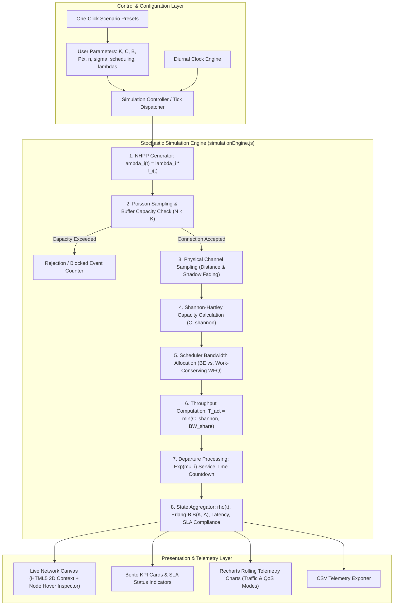

# WiFi Network Performance Simulator
### *Stochastic $M(t)/M/K/K$ Multi-Class Loss System & Wireless Propagation Engine*

[](https://wifi-simulation.vercel.app/)
[](https://react.dev/)
[](https://vitejs.dev/)
[](https://tailwindcss.com/)
[](https://recharts.org/)
[](https://opensource.org/licenses/MIT)

An industry-grade, interactive web-based simulation platform designed to model and evaluate **heterogeneous wireless network performance** under stochastic conditions. Built around an **$M(t)/M/K/K$ multi-class loss model**, the simulator bridges theoretical queueing systems, empirical propagation models, and MAC-layer scheduling mechanisms to analyze throughput degradation, blocking probabilities, and user starvation in high-density WiFi environments.

**Live Interactive Deployment**: [https://wifi-simulation.vercel.app/](https://wifi-simulation.vercel.app/)

---

## Table of Contents

- [Live Demo](#live-demo)
- [Overview & Problem Context](#overview--problem-context)
- [Why Stochastic Modeling?](#why-stochastic-modeling)
- [Key Features](#key-features)
- [System Architecture](#system-architecture)
- [Mathematical & Theoretical Formulation](#mathematical--theoretical-formulation)
  - [1. Queueing Model: $M(t)/M/K/K$ Multi-Class Loss System](#1-queueing-model-mtmkk-multi-class-loss-system)
  - [2. Non-Homogeneous Poisson Arrival Process (NHPP)](#2-non-homogeneous-poisson-arrival-process-nhpp)
  - [3. Wireless Channel Propagation & Shannon-Hartley Capacity](#3-wireless-channel-propagation--shannon-hartley-capacity)
  - [4. MAC Layer Scheduling: Best Effort vs. WFQ](#4-mac-layer-scheduling-best-effort-vs-wfq)
  - [5. System Stability & Erlang-B Blocking Probability](#5-system-stability--erlang-b-blocking-probability)
- [Traffic Classification Matrix](#traffic-classification-matrix)
- [Tech Stack & Engineering Design](#tech-stack--engineering-design)
- [Project Structure](#project-structure)
- [Getting Started](#getting-started)
- [Case Studies & Experimental Scenarios](#case-studies--experimental-scenarios)
- [Academic References](#academic-references)
- [Team & Acknowledgments](#team--acknowledgments)
- [License](#license)

---

## Live Demo

The application is deployed on Vercel and fully interactive in any modern browser:

**URL**: [https://wifi-simulation.vercel.app/](https://wifi-simulation.vercel.app/)

Features available in the live build:
* Real-time 60 FPS HTML5 Canvas radio spectrum visualizer
* Interactive node inspection on mouse hover (distance, $P_{\text{rx}}$, SINR, Shannon limit, SLA status)
* Side-by-side comparison between Best Effort and Weighted Fair Queueing (WFQ)
* 5 one-click scenario presets (Balanced, Bulk Download Spike, Collaboration Rush, Severe Shadowing, Night Streaming)
* CSV telemetry export for empirical evaluation and research logs

---

## Overview & Problem Context

In high-density environments (campuses, enterprise workspaces, cafes, and transportation hubs), a single IEEE 802.11 Access Point (AP) simultaneously serves users with sharply diverging traffic requirements:
- Low-latency interactive media (e.g., Zoom, Google Meet, VoIP)
- Throughput-intensive bulk data transfers (e.g., Google Drive, cloud backups)
- Web queries and bursty RESTful traffic
- Mission-critical low-payload financial transactions (e.g., QRIS, mobile banking)

When multi-class traffic competes for a finite wireless channel without adaptive QoS policies, **severe performance asymmetry** occurs. Bulk downloads saturate transmission queues, triggering bufferbloat, jitter spikes, and packet dropping that degrade latency-sensitive streams—while the bulk-download user observes nominal speed.

This project delivers a **first-principles mathematical simulation** with an intuitive, Apple/Vercel-inspired user interface, allowing network architects and researchers to simulate, visualize, and quantify these dynamics in real time.

---

## Why Stochastic Modeling?

Real-world wireless local area networks (WLANs) are governed by inherent uncertainties that cannot be captured by static, deterministic approximations:

1. **Independent Arrival Patterns**: Sessions from heterogeneous classes arrive independently, governed by stochastic Poisson processes with class-specific arrival rates $\lambda_i$.
2. **Diurnal Time-Varying Load (NHPP)**: User arrival rates fluctuate cyclically across day and night ($01:00$ to $24:00$), driving the system between light-load stability and peak-hour saturation.
3. **Stochastic Session Durations**: Holding times vary according to general continuous distributions with class-dependent mean service rates $\mu_i$.
4. **Log-Distance Path Loss & Random Shadow Fading**: Physical user locations $d_i \sim \text{Uniform}(d_{\min}, d_{\max})$ induce distance-dependent path loss, compounded by log-normal shadow fading $X_\sigma \sim \mathcal{N}(0, \sigma^2)$ due to obstacles and multi-path scattering.
5. **Shannon Upper Bound**: Actual instantaneous user throughput is constrained by physical signal quality ($\text{SINR}$), proving that equal bandwidth allocation at the scheduler level does not yield equal throughput at the receiver.

---

## Key Features

* **Real-Time 2D HTML5 Canvas Visualization**:
  * Centered AP with dynamic range circles ($25\%$, $50\%$, $75\%$, $100\%$ of $d_{\max}$).
  * Dynamic user nodes positioned by spatial coordinates and distance $d_i$.
  * Visual opacity reflecting instantaneous SINR / link quality.
  * Node arrival and departure particle feedback.
  * Retina / High-DPI crisp rendering scaling automatically with `window.devicePixelRatio`.
* **Interactive Node Telemetry Inspector**:
  * Hovering any active user node displays a floating popover showing individual RF link telemetry, distance, received signal power ($P_{\text{rx}}$), SINR, Shannon limit, scheduler share, and SLA compliance status.
* **Dual-Taxonomy Starvation Detection**:
  * **Physical-Channel Starvation**: Users suffering severe RF degradation ($\text{SINR} < 10\text{ dB}$) near the cell boundary, requiring physical relocation or AP densification.
  * **Scheduling-Limited Starvation**: Users receiving $< 60\%$ of fair share due to scheduler congestion or resource monopolization by aggressive classes.
* **Dynamic QoS Scheduling Comparison**:
  * **Best Effort (BE)**: Fair round-robin / equal slice ($C / N_{\text{total}}$).
  * **Weighted Fair Queueing (WFQ)**: Work-conserving Generalized Processor Sharing (GPS) priority-weighted allocation protecting mission-critical transactions and real-time collaboration.
* **Non-Homogeneous Poisson Process (NHPP) Engine**:
  * 5 discrete diurnal periods: Dini Hari (01:00–06:00), Pagi (06:00–11:00), Siang (11:00–14:00), Sore (14:00–20:00), and Malam (20:00–01:00).
  * Automated diurnal clock progression with speed multipliers ($0.5\times$, $1\times$, $2\times$, $4\times$).
* **Bento UI Metrics Dashboard**:
  * Active connections vs. total buffer capacity ($N / K$).
  * Empirical session blocking rate ($P_{\text{block}}$).
  * Instantaneous traffic intensity ($\rho(t)$) with stability threshold alerts ($\rho \ge 1.0$).
  * Theoretical Erlang-B blocking probability ($B(K, A)$).
  * Estimated RTT contention latency (ms).
  * SLA compliance percentage based on per-class bandwidth thresholds.
  * Per-class throughput distribution bars with active user counts and SLA target indicators.
* **Telemetry Charts via Recharts**:
  * Multi-metric timeline with switchable view modes: *Queueing & Traffic* and *QoS & Latency*.
* **One-Click Scenario Presets**:
  * Instantly test edge cases: Balanced Standard, Bulk Download Spike, Collaboration Rush, Severe Shadowing, and Night Streaming.
* **Data Export**:
  * Download complete simulation time-series telemetry in CSV format for research papers and laboratory analysis.

---

## System Architecture

The simulation engine is fully decoupled from the React rendering layer, ensuring deterministic calculations and high frame rates ($60\text{ FPS}$).



---

## Mathematical & Theoretical Formulation

### 1. Queueing Model: $M(t)/M/K/K$ Multi-Class Loss System
Using Kendall's extended queueing notation:
* **$M(t)$**: Non-stationary Markovian Poisson arrival process with diurnal rate variation $\lambda_i(t)$.
* **$M$**: Markovian (exponential) service duration distribution with class-specific parameter $\mu_i$ ($\text{Exp}(\mu_i)$).
* **$K$**: Number of concurrent parallel servers (maximum concurrent active wireless association slots).
* **$K$**: Total system capacity with zero waiting room; an arriving session finding all $K$ servers occupied is immediately blocked and dropped without queueing (pure loss system).
* **Multi-Class**: 6 distinct traffic classes with independent parameters $(\lambda_i, \mu_i, w_i)$.

### 2. Non-Homogeneous Poisson Arrival Process (NHPP)
Arrivals for each class $i \in \{0, \dots, 5\}$ follow an independent non-homogeneous Poisson process:
$$A_i(t) \sim \text{Poisson}(\lambda_i(t))$$
$$\lambda_i(t) = \lambda_{i,\text{base}} \times f_i(t)$$

By the superposition theorem of independent Poisson processes, the total arrival rate is:
$$\lambda_{\text{total}}(t) = \sum_{i=0}^5 \lambda_i(t)$$

### 3. Wireless Channel Propagation & Shannon-Hartley Capacity
For each newly arrived user $j$, the distance from the AP is uniformly sampled:
$$d_j \sim \text{Uniform}(d_{\min}, d_{\max})$$

Signal attenuation obeys the log-distance path loss model with log-normal shadow fading:
$$\text{PL}(d_j) = \text{PL}(d_0) + 10n \log_{10}\left(\frac{d_j}{d_0}\right) + X_\sigma \quad [\text{dB}]$$
where:
* $d_0 = 1.0\text{ m}$ (reference distance)
* $\text{PL}(d_0) = 40.0\text{ dB}$ (attenuation at $1\text{ m}$)
* $n$: Path loss exponent ($2.0 \le n \le 4.5$)
* $X_\sigma \sim \mathcal{N}(0, \sigma^2)$: Shadow fading random variable

The received power $P_{\text{rx}}(j)$ and Signal-to-Interference-plus-Noise Ratio ($\text{SINR}$) are:
$$P_{\text{rx}}(j) = P_{\text{tx}} - \text{PL}(d_j) \quad [\text{dBm}]$$
$$\text{SINR}(j) = \frac{10^{(P_{\text{rx}}(j) - 30)/10}}{10^{(P_{\text{noise}} - 30)/10}}$$
where thermal noise floor $P_{\text{noise}} = -90\text{ dBm}$.

By the **Shannon-Hartley theorem**, the physical channel upper bound is:
$$C_{\text{Shannon}}(j) = B \cdot \log_2(1 + \text{SINR}(j)) \quad [\text{Mbps}]$$
where $B$ is the channel bandwidth in MHz ($20, 40, 80\text{ MHz}$).

### 4. MAC Layer Scheduling: Best Effort vs. WFQ
The scheduler assigns each active user a nominal bandwidth share $\text{BW}_{\text{share}}$ based on the active policy:

* **Best Effort (BE - Equal Share)**:
  $$\text{BW}_{\text{share, BE}}(j) = \frac{C_{\text{AP}}}{N_{\text{total}}}$$

* **Weighted Fair Queueing (WFQ - Work-Conserving GPS)**:
  $$\text{BW}_{\text{share, WFQ}}(j) = \frac{C_{\text{AP}} \cdot w_{\text{class}(j)}}{\left(\sum_{k \in \text{Active}} w_k\right) \cdot N_{\text{class}(j)}}$$

The actual throughput achieved by user $j$ is the minimum of their physical channel capacity and scheduler quota:
$$T_{\text{actual}}(j) = \min\left(C_{\text{Shannon}}(j),\, \text{BW}_{\text{share}}(j)\right)$$

### 5. System Stability & Erlang-B Blocking Probability
Total offered load in Erlangs and normalized system traffic intensity:
$$A(t) = \sum_{i=0}^5 \frac{\lambda_i(t)}{\mu_i}, \qquad \rho(t) = \frac{A(t)}{K}$$

Under finite capacity of $K$ parallel connection servers and zero waiting buffer, the theoretical connection blocking probability is governed by the exact **Erlang-B loss formula** ($M/M/K/K$):
$$B(K, A(t)) = \frac{\frac{A(t)^K}{K!}}{\sum_{n=0}^K \frac{A(t)^n}{n!}}$$

In the simulation engine, this is evaluated using the numerically stable backwards recurrence:
$$B_0 = 1, \qquad B_m = \frac{A(t) \cdot B_{m-1}}{m + A(t) \cdot B_{m-1}} \quad \text{for } m = 1, 2, \dots, K$$

* **Stability criterion**: $\rho(t) < 1.0$. When $\rho(t) \ge 1.0$, offered traffic load exceeds the total server pool capacity $K$, driving peak connection rejections.

---

## Traffic Classification Matrix

| ID | Class Name | Typical Applications | Default $\lambda_i$ (usr/min) | $\mu_i$ (${\text{min}}^{-1}$) | Mean Sesi ($1/\mu_i$) | WFQ Weight ($w_i$) | SLA Min Target | QoS Sensitivity |
|:--:|:-----------|:---------------------|:-----------------------------:|:-----------------------------:|:---------------------:|:------------------:|:--------------:|:----------------|
| **0** | **Komunikasi** | WhatsApp, Telegram, VoIP, Email | `1.5` | `0.500` | $2.0\text{ min}$ | **4** | $\ge 0.3\text{ Mbps}$ | Latency, Jitter |
| **1** | **Pertukaran Data** | Google Drive, Dropbox, FTP | `0.8` | `0.100` | $10.0\text{ min}$ | **1** | $\ge 8.0\text{ Mbps}$ | Throughput |
| **2** | **Akses Info** | Web browsing, Portal Berita | `2.0` | `0.300` | $3.3\text{ min}$ | **3** | $\ge 1.0\text{ Mbps}$ | Page Load Time |
| **3** | **Hiburan** | YouTube, Netflix, Spotify | `1.2` | `0.020` | $50.0\text{ min}$ | **2** | $\ge 3.0\text{ Mbps}$ | Sustained Bitrate |
| **4** | **Transaksi** | Mobile Banking, QRIS, Payment API | `0.5` | `2.000` | $0.5\text{ min}$ | **5** | $\ge 0.2\text{ Mbps}$ | Loss, Initial Delay |
| **5** | **Kolaborasi** | Zoom, Google Meet, Miro | `0.6` | `0.015` | $66.7\text{ min}$ | **5** | $\ge 3.0\text{ Mbps}$ | Latency, Jitter, Loss |

### Diurnal Temporal Scaling Multipliers $f_i(t)$

| Time Window | Period Name | Komunikasi | Data Transfer | Akses Info | Hiburan | Transaksi | Kolaborasi |
|:-----------:|:------------|:----------:|:-------------:|:----------:|:-------:|:---------:|:----------:|
| **01:00 – 06:00** | Dini Hari | $0.3\times$ | $0.8\times$ | $0.2\times$ | $0.8\times$ | $0.2\times$ | $0.1\times$ |
| **06:00 – 11:00** | Pagi | $1.2\times$ | $0.9\times$ | $1.4\times$ | $0.6\times$ | $1.3\times$ | $1.5\times$ |
| **11:00 – 14:00** | Siang (Peak) | $1.5\times$ | $1.3\times$ | $1.8\times$ | $0.8\times$ | $1.8\times$ | $2.0\times$ |
| **14:00 – 20:00** | Sore | $1.3\times$ | $1.1\times$ | $1.2\times$ | $1.6\times$ | $1.2\times$ | $1.2\times$ |
| **20:00 – 01:00** | Malam | $1.0\times$ | $1.4\times$ | $0.8\times$ | $2.2\times$ | $0.6\times$ | $0.4\times$ |

---

## Tech Stack & Engineering Design

```
Frontend Architecture
├── Core: React 18 (Hooks, Refs, Context-free reactive state)
├── Build System: Vite 5 (Fast ESM HMR & optimized production bundling)
├── Styling: Tailwind CSS 3 (Apple Human Interface / Bento UI aesthetics)
├── Visualization: HTML5 Canvas 2D API (High-performance 60 FPS animation with DPI scaling)
└── Telemetry: Recharts 2 (Responsive SVG time-series charts)
```

### Engineering Highlights:
* **Zero Frame-Drop Rendering**: Canvas drawing runs on an isolated `requestAnimationFrame` loop driven by component references (`useRef`), preventing React re-render thrashing during continuous state steps.
* **Deterministic Discrete-Time Stepping**: The simulation clock advances by configurable increments ($\Delta t = 0.5\text{ simulated minutes}$ per tick) independent of presentation rendering.
* **Responsive Bento Layout**: Adapts cleanly across desktop displays with a collapsible control sidebar and dedicated metric telemetry cards.

---

## Project Structure

```bash
Wifi-Simulation/
├── index.html                   # HTML entry point with Inter & JetBrains Mono fonts
├── package.json                 # Dependency manifest and execution scripts
├── postcss.config.js            # PostCSS configuration for Tailwind
├── tailwind.config.js           # Custom design tokens (Apple-inspired palette)
├── vite.config.js               # Vite bundler configuration
└── src/
    ├── App.jsx                  # Main application orchestrator & layout shell
    ├── index.css                # Global styles, typography, and utility classes
    ├── main.jsx                 # React DOM mount entry
    ├── simulationEngine.js      # Pure mathematical engine (M(t)/M/K/K, Shannon, WFQ, CSV)
    └── components/
        ├── NetworkCanvas.jsx    # 2D Canvas renderer with hover telemetry popover
        ├── MetricDashboard.jsx  # Bento dashboard for KPIs and throughput bars
        ├── SidebarPanel.jsx     # Parameter control sliders and scenario presets
        └── TimelineChart.jsx    # Switchable real-time Recharts line graphs
```

---

## Getting Started

### Prerequisites
* **Node.js**: `v18.0.0` or higher
* **npm**: `v9.0.0` or higher

### Installation & Run

1. **Clone the repository:**
   ```bash
   git clone https://github.com/nael0407/Wifi-Simulation.git
   cd Wifi-Simulation
   ```

2. **Install dependencies:**
   ```bash
   npm install
   ```

3. **Start the local development server:**
   ```bash
   npm run dev
   ```
   Open your browser and navigate to `http://localhost:5173`.

4. **Build for production:**
   ```bash
   npm run build
   ```
   The compiled assets will be output to the `dist/` directory.

---

## Case Studies & Experimental Scenarios

### Scenario 1: Best Effort Collapse under Bulk Transfer Spike
* **Setup**: Increase *Pertukaran Data* arrival rate $\lambda_1 = 4.5\text{ usr/min}$, keep scheduling mode on `Best Effort`.
* **Observed Dynamic**: Because file transfer sessions have long holding times ($1/\mu_1 = 10\text{ min}$), active data users rapidly occupy capacity slots ($K$). Each user receives equal slice ($C/N$), causing the bandwidth of real-time classes (*Kolaborasi* & *Komunikasi*) to drop below their minimum acceptable threshold ($< 3\text{ Mbps}$), leading to audio-video stutter.

### Scenario 2: WFQ QoS Protection for High-Priority Traffic
* **Setup**: Switch scheduling mode to `WFQ` under the identical heavy-load condition above.
* **Observed Dynamic**: The WFQ scheduler enforces weight partitioning ($w_5 = 5$ for Collaboration vs. $w_1 = 1$ for Data Transfer). Collaboration streams sustain guaranteed bandwidth throughput even as bulk transfers queue up, verifying the isolation property of fair queueing.

### Scenario 3: Physical vs. Scheduling Starvation Disparity
* **Setup**: Set $d_{\max} = 45\text{ m}$ and increase Path Loss Exponent $n = 3.8$, $\sigma = 11\text{ dB}$.
* **Observed Dynamic**: Nodes situated in the outer ring display physical starvation with $\text{SINR} < 10\text{ dB}$, yielding Shannon capacities $< 1\text{ Mbps}$ despite ample scheduler quota. This demonstrates that QoS scheduling cannot overcome physical path loss without AP densification or transmission power adjustments.

---

## Academic References

1. **Kleinrock, L. (1975).** *Queueing Systems, Volume 1: Theory.* John Wiley & Sons. *(Foundational theory for Markovian loss systems, $M/M/m/m$ queues, and multi-class conservation laws).*
2. **Goldsmith, A. (2005).** *Wireless Communications.* Cambridge University Press. *(Log-distance path loss, log-normal shadowing, and Shannon capacity over fading channels).*
3. **Massey, W. A., & Whitt, W. (1994).** *An analysis of the modified offered-load approximation for the nonstationary Erlang loss model.* The Annals of Applied Probability, 4(4), 1145–1160. *(Mathematical justification for NHPP in telecommunications).*
4. **Parekh, A. K., & Gallager, R. G. (1993).** *A generalized processor sharing approach to flow control in integrated services networks: the single-node case.* IEEE/ACM Transactions on Networking, 1(3), 344–357. *(Foundations of Weighted Fair Queueing).*

---

## Team & Acknowledgments

Developed by Department of Electrical Engineering and Information Technology, **Universitas Gadjah Mada (UGM)**:

* **Natanael Sebastian Simanjuntak** — *24/542676/TK/60273* ([GitHub](https://github.com/nael0407))
* **Josiah Hermes** — *24/543958/TK/60463*
* **Aston Hugo** — *24/538303/TK/59700*

---

## License

This project is open-source and distributed under the [MIT License](LICENSE).
